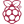
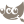

# Hi all, I’m @thekyria 👋

I am an [engineer](https://en.wiktionary.org/wiki/Reconstruction:Proto-Indo-European/meg%CA%B0-) :)

## I speak

<!-- Icons are local brand-colored copies from simple-icons (assets/icons), with *-dark.svg white variants for dark mode. Most are from v16.35.0; the Microsoft icons are from v11 and LinkedIn from v9, because newer releases no longer include them. -->

 
 

## I am casually using

<picture><source media="(prefers-color-scheme: dark)" srcset="https://raw.githubusercontent.com/thekyria/thekyria/main/assets/icons/windowsterminal-dark.svg"/></picture>

<picture><source media="(prefers-color-scheme: dark)" srcset="https://raw.githubusercontent.com/thekyria/thekyria/main/assets/icons/inkscape-dark.svg"/></picture>

<picture><source media="(prefers-color-scheme: dark)" srcset="https://raw.githubusercontent.com/thekyria/thekyria/main/assets/icons/markdown-dark.svg"/></picture>

<picture><source media="(prefers-color-scheme: dark)" srcset="https://raw.githubusercontent.com/thekyria/thekyria/main/assets/icons/pycharm-dark.svg"/></picture>

<picture><source media="(prefers-color-scheme: dark)" srcset="https://raw.githubusercontent.com/thekyria/thekyria/main/assets/icons/githubcopilot-dark.svg"/></picture>

<picture><source media="(prefers-color-scheme: dark)" srcset="https://raw.githubusercontent.com/thekyria/thekyria/main/assets/icons/github-dark.svg"/></picture>
<picture><source media="(prefers-color-scheme: dark)" srcset="https://raw.githubusercontent.com/thekyria/thekyria/main/assets/icons/vercel-dark.svg"/></picture>

<picture><source media="(prefers-color-scheme: dark)" srcset="https://raw.githubusercontent.com/thekyria/thekyria/main/assets/icons/llvm-dark.svg"/></picture>

 
 

## I am always interested in

- embedded
- networking
- power systems
- linear algebra
- devops
- qa

## Connect with me

[][linkedin]

[thekyria.com][website]

[//]: # (---------------- Links ----------------)

[website]: https://thekyria.com
[linkedin]: https://www.linkedin.com/in/theodoroskyriakidis/
